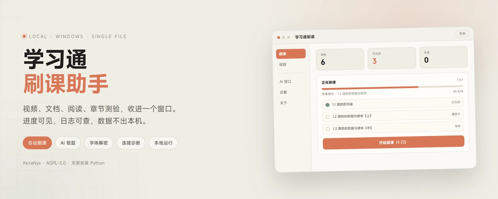
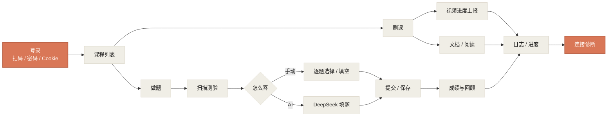
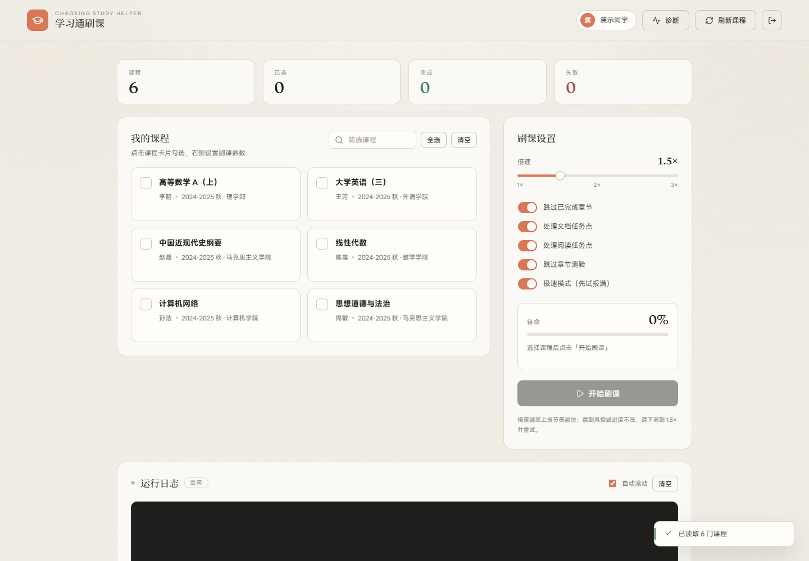
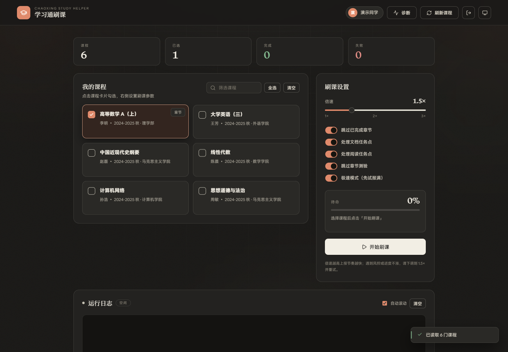
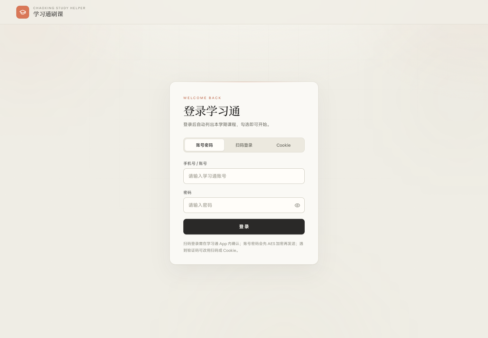
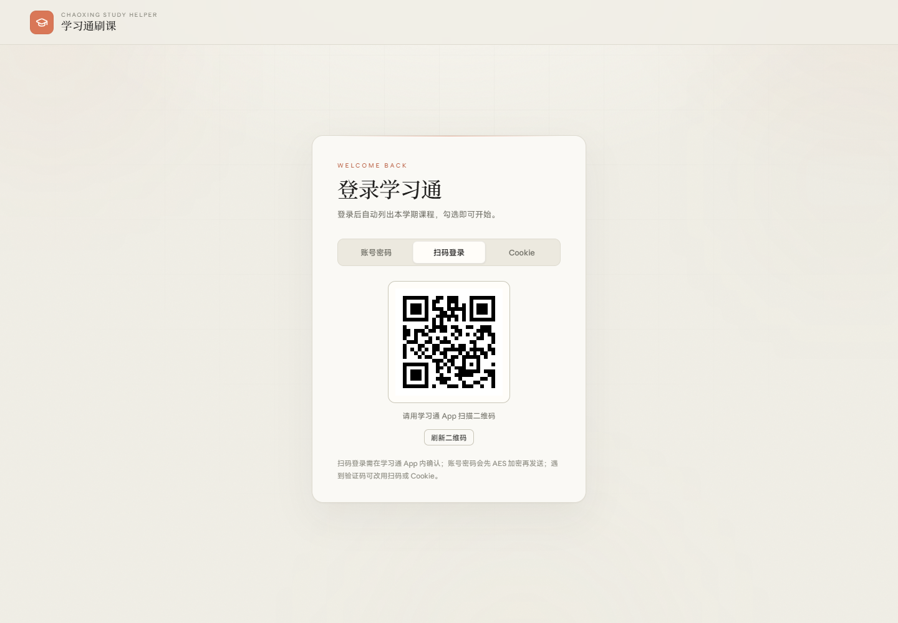

# 学习通刷课助手

> 一只住在本地的小鲸鱼，帮主人把视频播放键按完。
>
> 不碰账号密码服务器，不上传课程数据，不替你考试——只把重复劳动变少一点。

<p align="center">
  
</p>

<p align="center">
  <a href="#30-秒上手"></a>
  <a href="#能做什么"></a>
  <a href="#做题是怎么做的"></a>
  <a href="#许可证"></a>
  <a href="https://github.com/AkiraNyx/chaoxing-study-helper/releases"></a>
  <a href="https://github.com/AkiraNyx/chaoxing-study-helper"></a>
  
  
</p>

<details>
<summary><b>目录 · 点开</b></summary>

- [这玩意儿到底是啥](#这玩意儿到底是啥)
- [能做什么](#能做什么)
- [一张图看懂](#一张图看懂)
- [项目状态](#项目状态)
- [30 秒上手](#30-秒上手)
- [三种进门方式](#三种进门方式)
- [刷课是怎么刷的](#刷课是怎么刷的)
- [做题是怎么做的](#做题是怎么做的)
- [考试是怎么做的](#考试是怎么做的)
- [AI 接口](#ai-接口)
- [长什么样](#长什么样)
- [已知边界](#已知边界)
- [目录结构](#目录)
- [开发与测试](#开发与测试)
- [常见问题](#常见问题)
- [谁做的](#谁做的)
- [许可证](#许可证)

</details>

## 这玩意儿到底是啥

一个 Windows 桌面小工具，把学习通网页端的「看视频、读文档、做章节测验」这套操作，收进一个暖纸色的小窗口里。

- 不用装 Python，双击 `dist\学习通刷课.exe` 就能跑
- 没有黑框终端，没有原生标题栏
- 所有请求都在本机发出，界面里能看到每一步日志

如果它看起来像某个暖纸色的笔记应用，那只是审美选择；如果它偶尔犯蠢，那也不是巧合，是学习通又改页面了。

## 能做什么

| 功能 | 说明 |
| --- | --- |
| 三种登录 | 扫码 / 账号密码 / Cookie，总有一种能进门 |
| 记住登录 | 可选 DPAPI 加密保存会话，下次启动自动恢复；设置页可开关或清除 |
| 课程列表 | 搜索、多选、每门课显示「X 章 · Y 节 · 任务点 n/m」 |
| 自动刷课 | 视频、文档、阅读；倍速 1.0×–5.0×，实时日志和两位小数进度 |
| 独立做题块 | 扫描章节测验、搜索、按完成状态筛选、逐题作答 |
| 课程考试 | 读取考试列表、答题卡跳题、手动/AI 作答、逐题暂存后交卷 |
| AI 填题 | 配好 DeepSeek / OpenAI 兼容接口，单选、多选、判断、填空都能填 |
| 成绩回顾 | 做完的测验保留「回顾」，能看题目和得分 |
| 字体解密 | 学习通把题目换成加密字体时，自动按字形映射还原 |
| 连接诊断 | 登录、课程、任务点、测验页、AI、字体，一层层查 |

## 一张图看懂



## 项目状态

| 模块 | 状态 | 说明 |
| --- | --- | --- |
| 登录 | 🟢 可用 | 扫码 / 密码 / Cookie 三条路 |
| 刷课 | 🟢 可用 | 视频、文档、阅读；倍速与进度上报 |
| 做题扫描 | 🟡 看网络 | 首次要逐条打开测验页，之后读缓存 |
| 课程考试 | 🟡 部分实测 | 真实账号已读到考试列表与封面；开始/交卷待在可用考试上验证 |
| AI 填题 | 🟢 可用 | 需要自己配 Key；模型名以接口为准 |
| 字体解密 | 🟢 可用 | 生僻字形仍可能漏 |
| 连接诊断 | 🟢 可用 | 会真的打开一条测验页做检查 |

> 状态里的“可用”指本机验证过的链路，不代表学习通永远不会改页面。

## 30 秒上手

1. 双击 `dist\学习通刷课.exe`
2. 扫码，或用账号密码 / Cookie 登录
3. 在「刷课」勾选课程 → 调倍速 → 点「开始刷课」
4. 想做题就切到「做题」→「刷新测验」→ 点「作答」
5. 想考试就切到「考试」→「刷新考试」→「开始」（会立即开始计时）
6. 卡住了就点右上角「诊断」，它会告诉你哪一层断了

> 不想拉整个仓库？直接去 [Releases](https://github.com/AkiraNyx/chaoxing-study-helper/releases) 下载 `chaoxing-study-helper-v1.1.6.exe`。

> 首次启动会解包到临时目录，慢一两秒是正常的。SmartScreen 拦截就点「更多信息 → 仍要运行」。

## 三种进门方式

- **扫码（推荐）**：学习通 App 扫一下，自动轮询登录状态
- **账号密码**：走学习通登录接口，密码只在本机加密后发出
- **Cookie**：从浏览器复制整行 Cookie，适合扫码/密码被风控的时候

Cookie 默认只在内存里；勾选「记住登录状态」后，会用 Windows DPAPI 按当前用户加密存到 `%APPDATA%\学习通刷课\session.bin`，下次启动自动恢复，退出登录即删除。AI Key 存在同目录的 `config.json`，界面只显示「已保存」。

## 刷课是怎么刷的

不是模拟点击，是按网页端真实请求来：

- 课程 → 章节 → 任务点卡片
- 视频按 `playingTime` 定时上报，`enc` 按服务端模板实时计算
- 文档 / 阅读走对应任务接口
- 章节测验一律排到最后，交给「做题」块，不再混在视频中间

遇到 403、进度不涨、视频带人脸/弹题，工具会记录失败并提示，不会硬刚风控。倍速建议放在 2.0× 左右；更高倍速上报更密，风控风险也更大。

## 做题是怎么做的

1. 扫描：按勾选课程读任务点，再逐条打开测验页预检完成状态
2. 列表：搜索、全部 / 未完成 / 已完成筛选
3. 作答：一题一题显示，手动选或填；也可以「AI 填这题」
4. 提交：没答完会转保存，避免交白卷；已完成的只给回顾，不能重复交
5. 字体：测验页带 `cxSecretStyle` 时自动解码，题目不再是乱码

首次扫描要额外打开每条测验页，会慢一点；结果缓存 5 分钟，刷新按钮强制重扫。

## 考试是怎么做的

1. 在「考试」页点「刷新考试」，按勾选课程读取考试列表
2. 点「开始」会先读考试封面：已完成、需要人脸/人机验证、需要考试码都会提前提示
3. 确认进入后才开始计时，整卷题目一次拉取，右侧答题卡可以跳题
4. 可以手动作答，也可以点「AI 填这题」
5. 翻题/交卷会自动暂存；手动交卷要点两次确认，倒计时归零会自动交卷

只覆盖普通课程考试。人脸识别、人机验证、只允许 PC 客户端的考试，以及连线/排序/资料题等特殊题型，仍需要在学习通客户端完成。

如果封面提示「章节任务点未完成 100%」，先把「刷课」跑完，再回来刷新考试。

## AI 接口

在「AI 接口」页填：

- Base URL，默认 `https://api.deepseek.com`
- API Key
- 模型：接口 `/models` 返回什么就列什么，也可以直接手输，比如 `deepseek-v4.1-flash`
- 推理等级：默认 / 低 / 中 / 高，对应 `reasoning_effort`

模型名不是官方固定列表，中转站叫什么就填什么；填错会由接口自己报错，工具不猜。

API Key 以明文保存在本机的 `%APPDATA%\学习通刷课\config.json`，只在本机使用；不要把这份配置发给别人。

## 长什么样

| 浅色 | 深色 |
| --- | --- |
|  |  |

| 登录 | 扫码 |
| --- | --- |
|  |  |

还有 [章节预览](docs/chapters.png)、[连接诊断](docs/diagnose.png)。截图可能落后于最新界面，以实际窗口为准。

## 已知边界

- **风控 / 进度不确认**：倍速越高越容易出现 403，或视频到结尾但服务器仍不确认完成；遇到就降到 1.5×–2× 后重试
- **验证码 / 人脸**：本地无法自动处理，需要手动过
- **测验页改版**：提交字段和 DOM 可能变；真实环境第一次用，建议先拿一道不重要的测验试
- **字体映射缺口**：生僻字形可能没覆盖，会显示个别乱码
- **已完成测验**：只能回顾，不能重复提交
- **考试限制**：人脸识别、人机验证、PC 客户端限制与特殊题型无法自动处理；交卷前请自行检查答案

## 目录

```text
学习通刷课/
├─ dist/学习通刷课.exe     双击这个
├─ web/                    前端页面与资源
├─ docs/                   截图与文件清单（FILES.md）
├─ tests/                  模拟学习通 + 端到端测试
├─ server.py               本地服务 / API
├─ chaoxing.py             学习通客户端 / 刷课与考试
├─ ai_client.py            AI 客户端
├─ font_decoder.py         字体解密
├─ session_store.py        DPAPI 加密登录会话
├─ LICENSE                 AGPL-3.0
├─ NOTICE                  版权声明（AkiraNyx）
└─ ...
```

完整职责见 [docs/FILES.md](docs/FILES.md)。

## 开发与测试

```powershell
# 刷课端到端
python tests/test_pipeline.py

# HTTP API
python tests/test_server_api.py

# 扫码状态机
python tests/test_qr_login.py

# 测验保存/提交语义、会话失效清理、请求来源校验
python tests/test_quiz_api.py

# 考试列表 / 封面 / 开始 / 逐题暂存 / 交卷
python tests/test_exam.py

# 审查回归：会话隔离、答案语义、缓存身份、失败回滚
python tests/test_audit_regressions.py

# 本地考试演示（不连学习通）
python demo_exam.py

# 自检
python server.py --selftest

# 安装打包依赖后重新打包
python -m pip install -r requirements-build.txt
python build_exe.py
```

## 常见问题

<details>
<summary><b>展开：登录、99%、端口、AI 连接……</b></summary>

**登录提示验证码？**  
换扫码或 Cookie。账号密码触发风控时，本地处理不了验证码。

**课程列表空的？**  
先确认这学期有课、课程已开始；再检查 Cookie 是否过期。

**视频卡 99%？**  
多半带弹题或人脸。去网页手动过这一节，再回来刷剩下的。

**端口被占用？**  
软件优先使用本地 8765；被占用时会自动顺延到 8765–8784。关掉占用端口的程序，或退出另一个已经开着的实例。

**做完的测验还显示待作答？**  
打开一次让它读到测验页标记，再刷新列表；还不对就点「诊断」看测验页读取那一项。

**AI 测试连接失败？**  
先确认 Base URL 和 Key；中转站不一定支持 `/models`，但聊天接口可能仍然可用。

</details>

## 谁做的


这个项目的代码、界面和这份 README，由 **DeepSeek 模型** 在作者 **AkiraNyx** 的需求与审查下协助完成。署名作者是 AkiraNyx。

右边这只是文档吉祥物“鲸鱼娘”：蓝色渐变长发、呆毛、鲸鳍、大鲸尾、深蓝白女仆装，主食白饭，并且坚决否认自己胖。她只出现在文档里，不参与软件功能，也不代表学习通或 DeepSeek 官方。

**插画授权**：这张 Q 版基于上善无形「溟月」与 ZipZipPipe 的女仆鲸鱼娘二次设计，按 [CC BY-NC-SA 4.0](https://creativecommons.org/licenses/by-nc-sa/4.0/deed.zh) 使用——署名、非商业、相同方式共享。本次修改为 Q 版化、及踝长裙、白饭与鼓脸姿势。代码仍按 AGPL-3.0 发布；**插画不适用 AGPL，也不得商用**。

角色来源：[上善无形原帖](https://www.bilibili.com/opus/1231977657712771073)、[角色 turnaround](https://www.bilibili.com/opus/1238595424883834933)、[ZipZipPipe 空间](https://space.bilibili.com/4168597)。

> 谁再叫大肥鱼，她真的会鼓脸。

## 许可证

除 README 插画单独按 CC BY-NC-SA 4.0 使用外，本项目代码与文字文档以 **GNU Affero General Public License v3.0** 发布，完整条款见 [LICENSE](LICENSE)，版权声明见 [NOTICE](NOTICE)。

```text
Copyright (C) 2026 AkiraNyx

This program is free software: you can redistribute it and/or modify
it under the terms of the GNU Affero General Public License as published
by the Free Software Foundation, either version 3 of the License, or
(at your option) any later version.
```

简单说人话：

- 可以自用、修改、分发
- 分发修改版时，必须继续以 AGPL-3.0 开放源代码
- 如果把它做成网络服务给别人用，也要向使用者提供对应源码
- 不提供任何担保

第三方资源（anime.js、Lucide、内置字体，以及来自 nekro_chaoxing_study 的 `font_map_table.json`）仍归各自许可证所有，不在本项目 AGPL 覆盖范围内；再分发时请一并遵守它们的条款。

## 最后

这工具的目标不是“替主人学习”，是把机械点击和等待省下来。课还是得看，题还是得会；它只负责让过程没那么烦。

仅供个人学习进度管理使用。使用产生的后果由使用者自行承担，请遵守学校规章制度与学习通平台协议。

README 头图由本地 Codex 按项目界面渲染；Q 版鲸鱼娘基于上善无形与 ZipZipPipe 的角色设定二次绘制，按 CC BY-NC-SA 4.0 使用。
